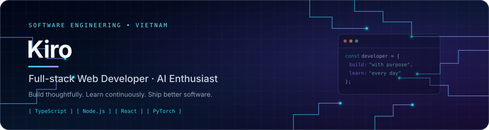
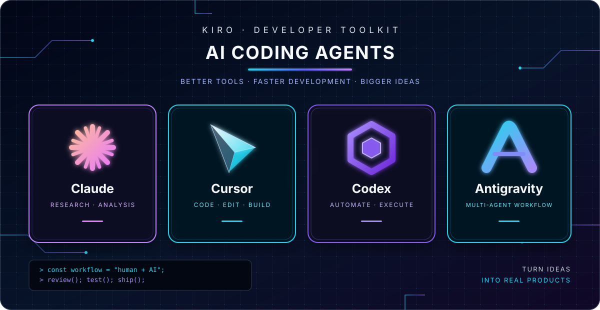

<!-- Profile README for https://github.com/luongviettienns -->

  

  <h1>Lương Việt Tiến | Kiro</h1>
  <h3>Software Engineering Student · Full-stack Web Development · AI Enthusiast</h3>

  

    
    
    
  

---

## 👋 About Me | Giới thiệu

**EN** — I'm Lương Việt Tiến, also known as **Kiro**, a Software Engineering student from Vietnam. I enjoy building practical web applications, designing backend services, working with databases, and exploring AI systems. I learn by building projects, reviewing trade-offs, and improving the reliability and maintainability of my code.

**VI** — Mình là **Lương Việt Tiến (Kiro)**, sinh viên ngành Kỹ thuật phần mềm tại Việt Nam. Mình yêu thích phát triển ứng dụng web, xây dựng backend, thiết kế cơ sở dữ liệu và tìm hiểu các hệ thống AI. Mình học thông qua dự án thực tế, chủ động đánh giá giải pháp và cải thiện chất lượng, khả năng bảo trì của mã nguồn.

- 🎓 **Field:** Software Engineering | Kỹ thuật phần mềm
- 🎂 **Date of birth:** 25 March 2005
- 💻 **Focus:** Full-stack Web Development, Backend Engineering, AI/ML
- 🌱 **Currently improving:** Software architecture, testing, database design, and deployment practices
- 📫 **Email:** [luongviettienns@gmail.com](mailto:luongviettienns@gmail.com)

## 🧰 Tech Stack | Công nghệ sử dụng

### Languages

  
  
  

### Frontend & Mobile

  
  
  
  
  

### Backend, Database & Real-time

  
  
  
  
  

### AI, Machine Learning & Tools

  
  
  

## 🤖 AI Coding Agents | Công cụ AI hỗ trợ lập trình

I am proficient in AI-assisted coding workflows with Claude, Cursor, OpenAI Codex, and Google Antigravity. I use these tools for codebase exploration, implementation, refactoring, debugging, documentation, and test assistance—while reviewing and verifying generated changes instead of treating AI output as automatically correct.

Mình sử dụng các AI coding agent để hỗ trợ đọc hiểu codebase, triển khai tính năng, tái cấu trúc, gỡ lỗi, viết tài liệu và xây dựng kiểm thử. Mình vẫn chủ động đọc lại, kiểm tra và xác minh kết quả do AI tạo ra.

  

  
    <a href="https://claude.ai/">Claude</a> ·
    <a href="https://cursor.com/">Cursor</a> ·
    <a href="https://openai.com/codex/">OpenAI Codex</a> ·
    <a href="https://antigravity.google/">Google Antigravity</a>
  

## 🚀 Featured Projects | Dự án nổi bật

### 🧠 [CoVayAI — AlphaZero for Go](https://github.com/luongviettienns/CoVayAI)

**Python · PyTorch · Deep Learning · Reinforcement Learning**

An AI project exploring an AlphaZero-style approach to Go, combining a policy/value neural network, Monte Carlo Tree Search (MCTS), self-play, and model evaluation.

Dự án AI cờ vây theo hướng AlphaZero, kết hợp mạng nơ-ron policy/value, thuật toán tìm kiếm cây Monte Carlo (MCTS), tự đấu và đánh giá mô hình.

### 🍔 [WebAppQuanLyNhaHang — Crispy Bite](https://github.com/luongviettienns/WebAppQuanLyNhaHang)

**React Native · Expo · TypeScript · Node.js · Express · Prisma · MySQL · Socket.IO**

A restaurant ordering and management application designed around a client-server architecture, with real-time communication for front-of-house and kitchen workflows.

Ứng dụng đặt món và quản lý nhà hàng theo kiến trúc client-server, hướng tới đồng bộ thời gian thực giữa hoạt động tại quầy và khu vực bếp.

### 🧭 [IT-Compass](https://github.com/luongviettienns/IT-Compass)

**Web Development · Career Orientation · Mentorship**

A career-orientation platform designed to help learners explore IT career paths, discover suitable majors, and connect with mentors.

Nền tảng định hướng nghề nghiệp CNTT, hỗ trợ người học khám phá lĩnh vực phù hợp, tìm hiểu chuyên ngành và kết nối với người hướng dẫn.

## 📊 GitHub Overview | Hoạt động GitHub

  
  

## 🎯 Goals | Mục tiêu

- Build maintainable, secure, and reliable applications.
- Improve software architecture, testing, and database design skills.
- Strengthen full-stack engineering fundamentals and deployment practices.
- Explore practical applications of AI and machine learning.
- Learn from other developers and contribute to meaningful projects.

Mình hướng tới việc xây dựng ứng dụng dễ bảo trì, an toàn và đáng tin cậy; nâng cao tư duy thiết kế hệ thống, kiểm thử, cơ sở dữ liệu, triển khai sản phẩm và tìm hiểu ứng dụng AI/ML thực tế.

---

  <i>“Build with purpose. Learn continuously. Improve every day.”</i>
   
  Học hỏi không ngừng · Xây dựng có mục tiêu · Tiến bộ mỗi ngày

